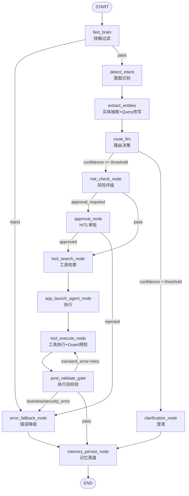
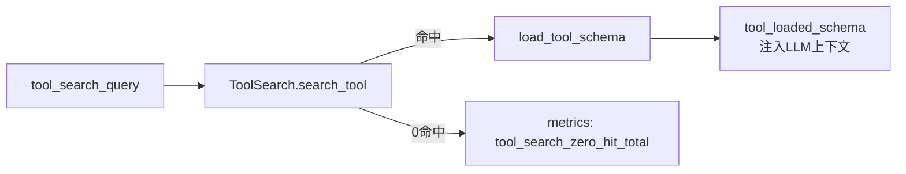
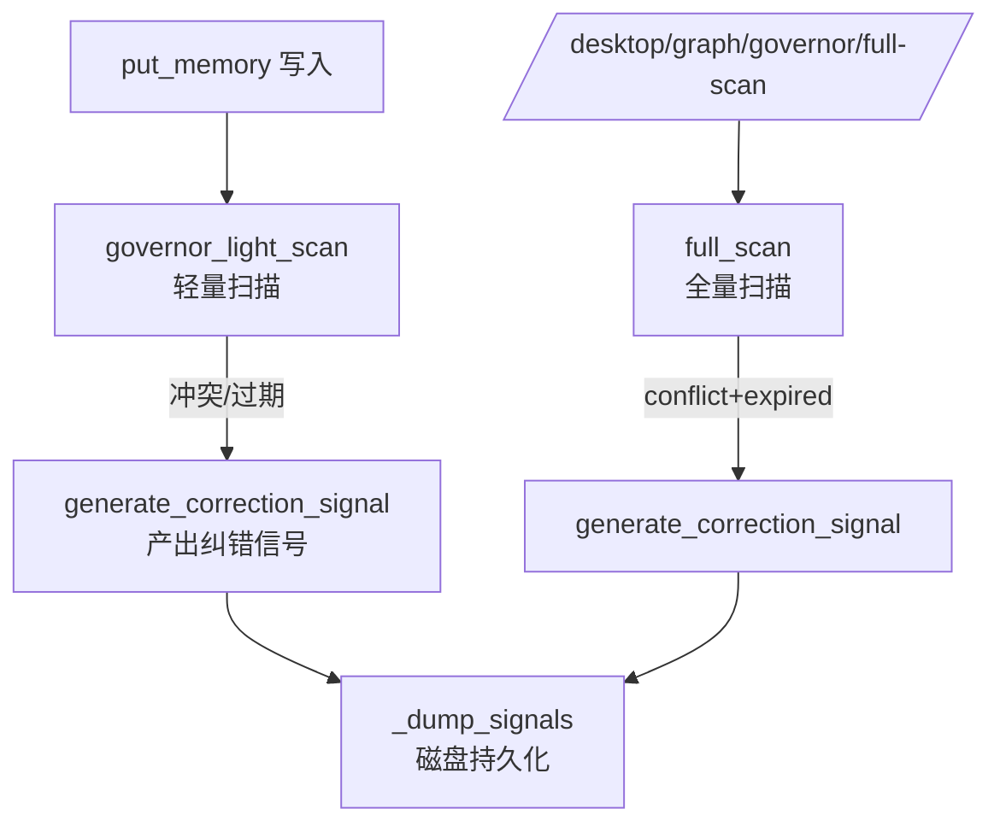
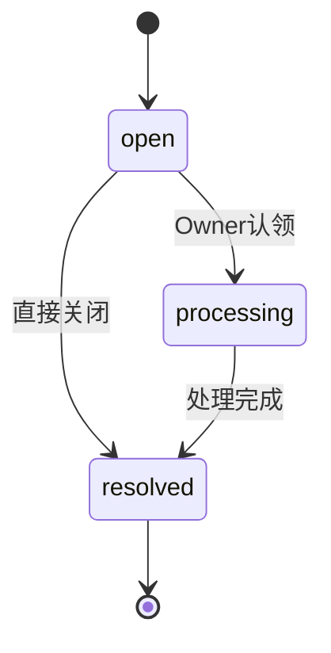
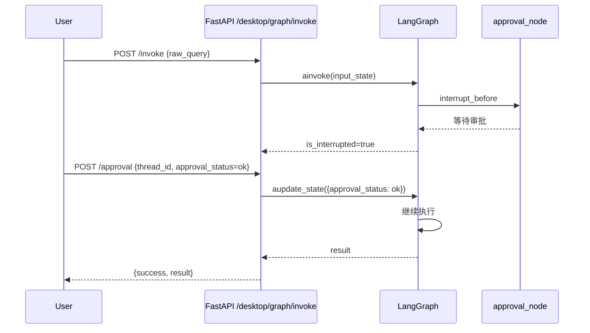
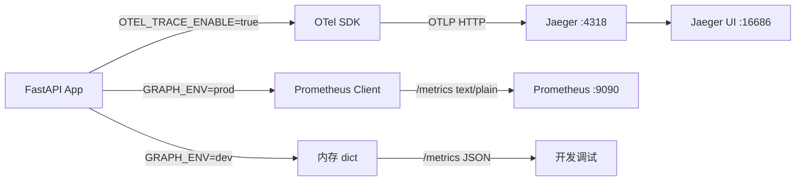
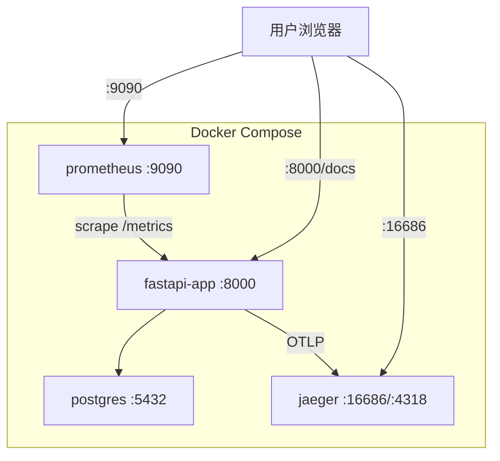

# Desktop-Agent LangGraph 流9程图

## 主执行流程



## Tool-Search 延迟加载



## Governor 治理流程



## 信号状态机



## HITL 人工审批流程



## LLM 调用 + 重试 + 降级

```mermaid
flowchart TD
    CALL[llm_parse_with_retry] --> TRY[LLM API调用]
    TRY -->|成功+parse成功| OK[返回 parsed模型]
    TRY -->|成功+parse失败| FALL[返回 None + raw<br/>⚠️ 禁止重试]
    TRY -->|异常| CHECK{is_transient?}
    CHECK -->|是: 429/5xx/Timeout| RETRY[重试 max_retry次]
    RETRY --> TRY
    CHECK -->|否: 400/401/403| FALL
    RETRY -->|达到上限| FALL
    
    FALL --> DEGRADE[业务函数降级兜底]
    DEGRADE -->|detect_intent| D1["unknown", 0.0]
    DEGRADE -->|route| D2["clarification_node", {}, 0.0]
    DEGRADE -->|rewrite| D3["raw_query, [raw_query]"]
```

## 可观测性架构



## Docker 部署架构

