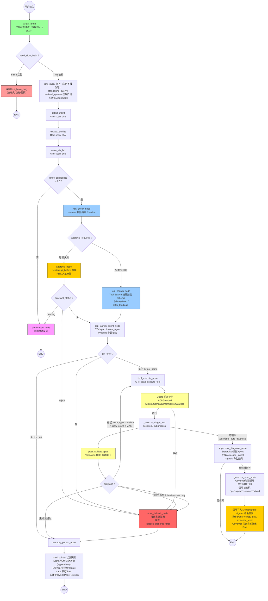

# 桌面控制 Agent 完整链路流程图



## 节点说明

| 节点 | OTel Span | 职责 |
|------|-----------|------|
| fast_brain | — | 快脑前置过滤，纯规则无LLM，拦截空输入/空格/乱码 |
| detect_intent | chat | 意图识别，返回 (intent, confidence) |
| extract_entities | chat | 结构化实体抽取 |
| route_via_llm | chat | LLM 路由，返回 (agent, args, confidence) |
| clarification_node | — | 低置信度/高风险，结构化反问用户 |
| risk_check_node | — | Harness 风险分级 Checker（非LLM硬编码） |
| approval_node | — | **HITL 人工审批**，interrupt_before 暂停，外部 update_state 写入审批结果 |
| tool_search_node | — | Tool-Search 工具检索，defer_loading 按需加载 schema |
| app_launch_agent_node | invoke_agent | Agent 执行，Pydantic 参数校验 |
| tool_execute_node | execute_tool | Guard 前置护栏 + 底层工具执行 |
| post_validate_gate | — | Validation Gate 验收闸门（进程存活探测）；校验失败走 error_fallback_node 降级 |
| governor_scan_node | — | Governor 治理循环，冲突/过期扫描，生成 correction_signal；信号具备状态机 open→processing→resolved |
| supervisor_diagnose_node | — | Supervisor 诊断 Agent，失败后分析 trace，生成纠错信号；复用 Governor signals 命名空间 |
| error_fallback_node | — | 降级 Fallback，返回友好提示；埋点 fallback_triggered_total |
| memory_persist_node | — | checkpointer 快照 + Store A/B级证据落盘（append-only）；实体更新追加 PageRevision |

## 条件边路由

| 条件边 | 判断条件 | 去向 |
|--------|----------|------|
| route_after_llm | confidence < 0.7 | clarification_node |
| route_after_risk | approval_required | approval_node |
| route_after_approval | approval_status=pending | clarification_node |
| route_after_approval | approval_status=ok | app_launch_agent_node |
| route_after_approval | approval_status=reject | error_fallback_node |
| route_after_agent | last_error 存在 | error_fallback_node |
| route_after_validate | 校验失败 | error_fallback_node |
| route_after_validate | error_type=security/business | error_fallback_node |
| route_after_validate | error_type=transient 且 retry<MAX | tool_execute_node |

## HITL 人工审批流程

```
1. graph.ainvoke(state, config)
   → 执行到 approval_node 前暂停（interrupt_before）
   → 返回当前 state，approval_status='pending'

2. 外部审批接口接收用户确认/拒绝:
   graph.update_state(config, {'approval_status': 'ok'}, 'approval_node')

3. 恢复执行:
   result = await graph.ainvoke(None, config)
   → approval_status='ok' → 继续到 app_launch_agent_node
   → approval_status='reject' → 走 error_fallback_node
```

## 错误类型区分

| error_type | 含义 | 重试策略 |
|------------|------|----------|
| security | 命令注入、非法参数 | 禁止重试，直接降级 |
| business | Validation Gate 失败、工具返回错误 | 禁止重试，直接降级 |
| transient | 网络超时、进程启动超时 | RetryPolicy，最多 MAX_RETRIES 次 |

## 信号状态机流转

```
correction_signal 生成
  → status: open（等待 Owner 处理）
  → status: processing（Owner 认领处理中）
  → status: resolved（处理完成，人工/自动关闭）

PATCH /desktop/governor/signals/{signal_id}
请求体: {"status": "resolved", "owner": "human-admin", "comment": "人工处理完成"}
```

> Governor 禁止自动修改 Fact；信号只上报，交给 Owner/人工处理。
> Supervisor 产出的 correction_signal 复用同一 signals 命名空间。

## Time Travel 时间旅行

```
GET  /desktop/graph/checkpoints?thread_id=xxx    # 获取历史 checkpoint 快照列表
POST /desktop/graph/fork                         # 回溯到指定 checkpoint_id，fork 出新分支
```

> 底层 Checkpointer 已支持时间旅行，业务层暴露 API 可用于调试失败任务、A/B 分支实验。

## 双埋点可观测架构

| 环境 | 技术 | 用途 |
|------|------|------|
| 生产 | OTel GenAI Trace | 五层标准 Span，trace_id 全链路透传，参数只存 hash，原始参数 opt-in 独立存储 |
| 开发/测试 | LangFuse 本地 Docker | Agent 调试、可视化、数据集批量评估 |
| 联动 | trace_id / session_id | 线上 OTel 异常 → LangFuse 拉取完整会话样本复盘 |